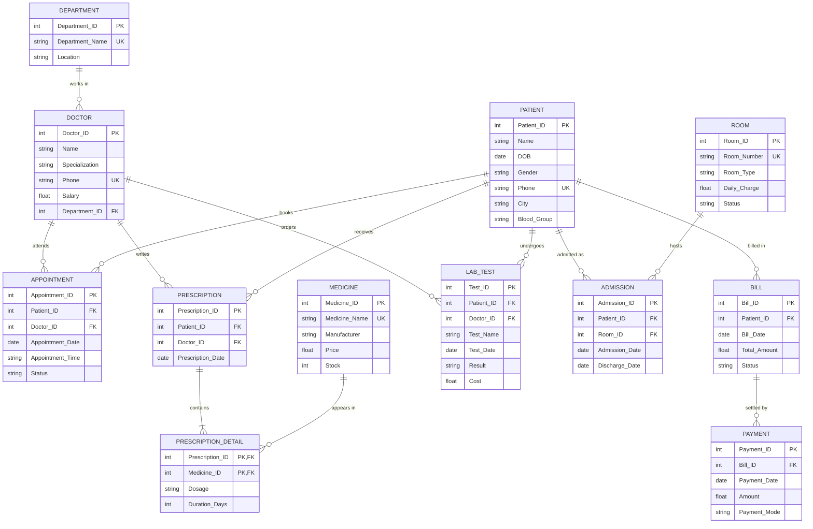

# 1. ER Model — Hospital Management System

*Chen notation: rectangle = entity, diamond = relationship, oval = attribute,
underlined = key attribute, red labels = cardinality.*

## Entities

| Entity | Key attribute | Other attributes |
|---|---|---|
| DEPARTMENT | <u>Department_ID</u> | Department_Name, Location |
| DOCTOR | <u>Doctor_ID</u> | Name, Specialization, Phone, Salary |
| PATIENT | <u>Patient_ID</u> | Name, DOB, Gender, Phone, City, Blood_Group |
| ROOM | <u>Room_ID</u> | Room_Number, Room_Type, Daily_Charge, Status |
| MEDICINE | <u>Medicine_ID</u> | Medicine_Name, Manufacturer, Price, Stock |
| PRESCRIPTION | <u>Prescription_ID</u> | Prescription_Date |
| LAB_TEST | <u>Test_ID</u> | Test_Name, Test_Date, Result, Cost |
| BILL | <u>Bill_ID</u> | Bill_Date, Total_Amount, Status |
| PAYMENT | <u>Payment_ID</u> | Payment_Date, Amount, Payment_Mode |

## Relationships

| Relationship | Between | Cardinality | Relationship attributes | Becomes table |
|---|---|---|---|---|
| Works_In | DEPARTMENT – DOCTOR | 1 : N | — | FK `Department_ID` in DOCTOR |
| Appointment | DOCTOR – PATIENT | M : N | Appointment_ID, Date, Time, Status | **APPOINTMENT** |
| Writes | DOCTOR – PRESCRIPTION | 1 : N | — | FK `Doctor_ID` in PRESCRIPTION |
| Receives | PATIENT – PRESCRIPTION | 1 : N | — | FK `Patient_ID` in PRESCRIPTION |
| Contains | PRESCRIPTION – MEDICINE | M : N | Dosage, Duration_Days | **PRESCRIPTION_DETAIL** |
| Orders | DOCTOR – LAB_TEST | 1 : N | — | FK `Doctor_ID` in LAB_TEST |
| Undergoes | PATIENT – LAB_TEST | 1 : N | — | FK `Patient_ID` in LAB_TEST |
| Admitted_In | PATIENT – ROOM | M : N | Admission_ID, Admission_Date, Discharge_Date | **ADMISSION** |
| Billed | PATIENT – BILL | 1 : N | — | FK `Patient_ID` in BILL |
| Settles | BILL – PAYMENT | 1 : N | — | FK `Bill_ID` in PAYMENT |

## ER → relational mapping rules used

1. Every **strong entity** → its own table, key attribute → primary key.
2. **1 : N** relationship → put the primary key of the "1" side as a **foreign key** in the "N" side.
3. **M : N** relationship → a **new table** whose key combines both sides' keys
   (we use a surrogate key `Appointment_ID` / `Admission_ID`, and a composite key
   `(Prescription_ID, Medicine_ID)` for PRESCRIPTION_DETAIL).
4. Relationship attributes go into the table created for the relationship.

## Crow's-foot version (renders automatically on GitHub)

