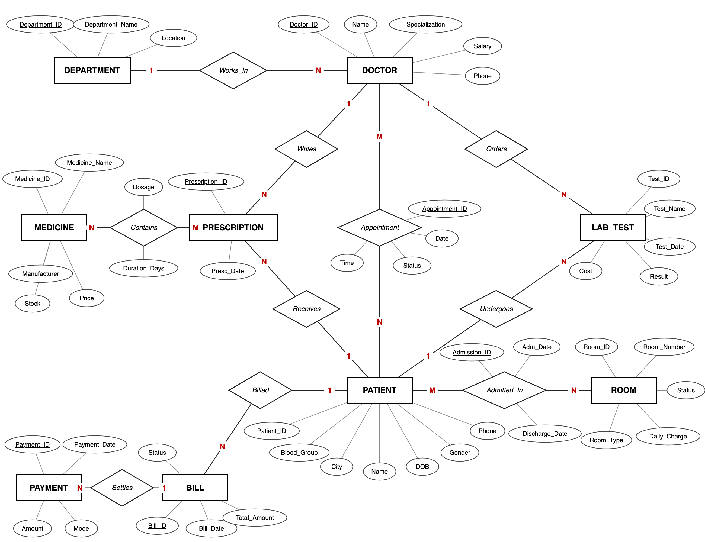

# 🏥 Hospital Management System — DBMS Group Project

A relational database for a hospital that manages **patients, doctors, departments,
appointments, admissions, rooms, prescriptions, medicines, lab tests, bills and
payments**. It is built in **Oracle SQL and PL/SQL**, with the relational-algebra,
relational-calculus and normalization theory worked out on the same database.



## Team

| Member | Role | Owns |
|---|---|---|
| Member 1 — *Name (Reg. No.)* | Database Designer | `ER-Diagram/`, `Database-Schema/` |
| Member 2 — *Name (Reg. No.)* | SQL Developer | `SQL/` |
| Member 3 — *Name (Reg. No.)* | Relational Theory | `Relational-Algebra/`, `Relational-Calculus/`, `Relational-Model/` |
| Member 4 — *Name (Reg. No.)* | Normalization & PL/SQL | `Normalization/`, `PL-SQL/` |

## Syllabus coverage

| # | Topic | Where |
|---|---|---|
| 1 | ER Model | [ER-Diagram/](ER-Diagram/README.md) |
| 2 | Schema | [Database-Schema/schema.md](Database-Schema/schema.md), [data-dictionary.md](Database-Schema/data-dictionary.md) |
| 3 | Keys | [Database-Schema/schema.md#keys](Database-Schema/schema.md#keys) |
| 4 | Relational schema queries | [SQL/01_create_tables.sql](SQL/01_create_tables.sql), [SQL/03_basic_queries.sql](SQL/03_basic_queries.sql) (Part A) |
| 5 | Relational algebra | [Relational-Algebra/relational-algebra.md](Relational-Algebra/relational-algebra.md) |
| 6 | Relational calculus | [TRC.md](Relational-Calculus/TRC.md), [DRC.md](Relational-Calculus/DRC.md) |
| 7 | Set operations, renaming, join, division, syntax | [SQL/05_joins.sql](SQL/05_joins.sql), [SQL/06_set_operations_renaming_division.sql](SQL/06_set_operations_renaming_division.sql), RA file |
| 8 | Operators, grouping, ungrouping, relational comparison | [SQL/04_operators_and_comparison.sql](SQL/04_operators_and_comparison.sql), [SQL/07_aggregate_and_grouping.sql](SQL/07_aggregate_and_grouping.sql), RA file |
| 9 | Relational database model | [Relational-Model/relational-model.md](Relational-Model/relational-model.md) |
| 10 | Normalization | [Normalization/normalization.md](Normalization/normalization.md) |
| 11 | SQL | [SQL/](SQL/) |
| 12 | PL/SQL | [PL-SQL/](PL-SQL/): functions, procedures, cursors, triggers |

## Database at a glance

| Table | Rows | Table | Rows |
|---|---|---|---|
| Department | 6 | Medicine | 12 |
| Doctor | 10 | Prescription | 15 |
| Patient | 15 | Prescription_Detail | 29 |
| Appointment | 20 | Lab_Test | 16 |
| Room | 10 | Bill | 16 |
| Admission | 9 | Payment | 16 |

## How to run

Use **Oracle Live SQL** (free, in the browser: <https://livesql.oracle.com>), or any
Oracle 19c+ database with SQL Developer / SQL*Plus. Run the files **in this order**:

```text
SQL/00_drop_tables.sql            (only when re-running; errors on the first run are normal)
SQL/01_create_tables.sql
SQL/02_insert_data.sql
SQL/03_basic_queries.sql … SQL/08_nested_queries_and_views.sql
PL-SQL/01_functions.sql
PL-SQL/02_procedures.sql
PL-SQL/03_cursors.sql
PL-SQL/04_triggers.sql
```

> `02_procedures.sql` commits a new appointment and a discharge as part of its
> demo, so re-run `00 → 02` if you want the original data back.

## Repository structure

```text
HMS-DBMS-Group-Project/
├── README.md
├── ER-Diagram/            ER diagram (PNG + SVG), entities, relationships, mapping
├── Database-Schema/       relational schema, keys, constraints, data dictionary
├── SQL/                   00–08: DDL, data, queries
├── Relational-Algebra/    RA expressions incl. division, grouping, comparison
├── Relational-Calculus/   TRC and DRC
├── Relational-Model/      relational model concepts
├── Normalization/         UNF → 1NF → 2NF → 3NF → BCNF
├── PL-SQL/                functions, procedures, cursors, triggers
├── Screenshots/           output screenshots (SQL/, PL-SQL/)
├── Documentation/         project report
├── Presentation/          PPT
└── docs/GIT-WORKFLOW.md   how the team uses branches and pull requests
```

## Team workflow

Each member works on their own branch (`member-1-design`, `member-2-sql`,
`member-3-relational`, `member-4-plsql`) and opens a pull request that another
member reviews before it is merged into `main`. See [docs/GIT-WORKFLOW.md](docs/GIT-WORKFLOW.md).

## Technologies

Oracle Database · SQL · PL/SQL · Git · GitHub
